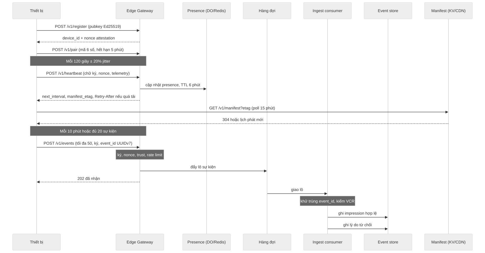

# AMS: kiến trúc

Nguồn: `DAC-TA-GIAO-VIEC-AGENT.md` (mục 3, 4, 5, 7, 8, 9, 11) và `PLAN.md` (§2 đến §4). Khi hai tài liệu mâu thuẫn, `PLAN.md` thắng về cấu trúc mã. Sơ đồ nguồn Mermaid ở `docs/diagrams/*.mmd`, bản vẽ `*.svg` sinh bằng `mmdc`.

## 1. Ba môi trường, một mã nguồn

Mã nghiệp vụ chỉ nhận `deps: Runtime` (`packages/runtime`), không import trực tiếp pg, ioredis, D1. Chuyển môi trường là đổi adapter và cấu hình, không viết lại nghiệp vụ.



| Môi trường | Mục đích | Quy mô | Ghi chú |
|---|---|---|---|
| Docker local (PC) | Phát triển, demo, nghiệm thu chức năng | 10 đến 50 nghìn thiết bị ảo | `make up`; không đo được chi phí hay giới hạn ở 1M+ |
| Cloudflare | Bản chạy thật đầu tiên | 1 đến 3 triệu | Workers + D1 + KV + DO + Queues/Pipelines + R2 |
| Hạ tầng riêng | Khi chi phí hoặc giới hạn Cloudflare không còn phù hợp | 10 triệu trở lên | Gateway Go, Redpanda, ClickHouse, Postgres, Redis; Cloudflare giữ CDN, WAF, DNS, media |

## 2. Tổng thể hệ thống



Nguyên tắc: tách **đường nóng** (ghi append-only, khối lượng rất lớn) khỏi **đường quản trị** (giao dịch, tiền, quyền; khối lượng nhỏ, đòi hỏi nhất quán).

| | Đường nóng | Đường quản trị |
|---|---|---|
| Thành phần | edge-gateway, ingest-consumer, presence, event store | api, payments, scheduler, settlement, contracts, transcoder |
| Dữ liệu | heartbeat, impression, proof-of-play (bất biến, có TTL) | user, chiến dịch, hợp đồng, ví, audit (giao dịch, ACID) |
| Lưu trữ | DO/Redis, Queues/Redpanda, R2 Parquet/ClickHouse | D1/PostgreSQL, R2/S3 |
| Nhất quán | Cuối cùng; khử trùng theo `event_id` | Mạnh; tiền chỉ đi qua câu lệnh nguyên tử có điều kiện |
| Lỗi | Mất heartbeat chấp nhận được; mất impression không chấp nhận (thiết bị giữ hàng đợi ngoại tuyến) | Mọi lỗi phải có audit và đối soát |
| Giao dịch giữa hai đường | Chỉ một chiều: đường quản trị đọc bảng gộp; settlement đối soát impression với sổ cái |

### 2.1 Luồng thiết bị



- Heartbeat 120 giây ± 20% (jitter), server điều khiển `next_interval`, có `Retry-After` khi quá tải. Online nếu `last_seen < 2,5 × chu kỳ`.
- Sự kiện gửi theo lô (tối đa 50), ký Ed25519, nonce chống phát lại, idempotent theo `event_id` (UUIDv7 do thiết bị sinh). Thiết bị `trust_level = 0` (giả lập, thiếu chứng thực) không được tính hoa hồng.
- Manifest cache theo `region × daypart × model_class`, trả 304 nếu `etag` không đổi. Có thể phục vụ trực tiếp từ CDN/R2 công khai, không qua Worker (xem COST-MODEL, phương án D).
- Không giữ WebSocket cho toàn bộ thiết bị; WebSocket chỉ cho nhóm giám sát trực tiếp (1 đến 2%).

### 2.2 Luồng tài chính: ví và SePay



Thứ tự xử lý (đặc tả mục 8.3, hợp đồng API ở PLAN §4):

| Bước | Hành động | Cơ chế | Kết quả khi lỗi |
|---|---|---|---|
| 0 | Lưu nguyên văn payload | `payment_webhooks` (kể cả bị từ chối) | Luôn có dấu vết |
| 1 | Khử trùng | `provider_txn_id` / `event_id` UNIQUE | Trả `{"success":true}`, không cộng lần hai |
| 2 | Xác thực | HMAC-SHA256 `X-SePay-Signature`, so sánh hằng thời gian; timestamp lệch >5 phút bị từ chối; hoặc `Authorization: Apikey` | 401, `signature_ok = 0` |
| 3 | Chỉ nhận `transferType = in` | | Bỏ qua, ghi log |
| 4 | Đối chiếu | Tiền tố `AMS` + mã khách + số tiền | Hàng đợi xử lý thủ công của Tài chính |
| 5 | Cộng ví | `topups` + `wallet_entries` (chỉ INSERT) + cập nhật cache `ad_wallets` trong một transaction | Rollback toàn bộ |
| 6 | Tự kích hoạt | Chiến dịch `awaiting_funds` được giữ ngân sách theo thứ tự duyệt; khách `pending_payment` đạt mức tối thiểu thì `active`, hợp đồng `pending_sign` thành `active`, tạo tài khoản cổng; dưới mức tối thiểu chỉ cộng ví | `activation_log`, có thể hoàn tác |
| 7 | Phản hồi | HTTP 200 + `{"success":true}` trong vài giây (SePay chờ tối đa 30 giây) | SePay retry tối đa 7 lần |

Chống đua: không dùng khóa hàng (D1/SQLite không có `FOR UPDATE`); dùng `UPDATE ... WHERE available >= ?` kiểm `rowsAffected` và ràng buộc UNIQUE. Đối soát hằng ngày bằng API giao dịch SePay để bù webhook thiếu. Khả dụng = số dư trừ tiền đang giữ; không bao giờ chi vượt phần đã giữ.

## 3. Mô hình dữ liệu tóm tắt

| Nhóm | Bảng chính | Nơi lưu | Ghi chú |
|---|---|---|---|
| Người dùng, quyền | `tenants`, `admins`, `admin_permissions`, `campaign_grants`, `upload_quotas`, `audit_log` | Giao dịch | RBAC 6 vai trò × 12 mô-đun × 4 hành động; `audit_log` chỉ INSERT |
| Thiết bị | `end_users`, `devices` (shard = hash(id) % 4096), `device_attestations` | Giao dịch | Khóa công khai Ed25519, `trust_level` |
| Địa điểm, màn hình | `venues`, `screens`, `screen_groups` | Giao dịch | 3 loại: tv, elevator, led_p5 |
| Khách hàng, hợp đồng | `customers`, `contracts`, `contract_lines`, `receivables` | Giao dịch | MST, tài khoản ngân hàng mã hóa theo trường (AES-GCM) |
| Quảng cáo | `campaigns`, `creatives`, `schedule_slots`, `partners`, `rtb_floors` | Giao dịch | Một bộ creative cho mỗi loại màn/độ phân giải |
| Tiền | `ad_wallets` (cache), `wallet_entries` (sổ cái), `topups`, `payment_webhooks`, `activation_rules/log`, `invoices`, `payouts`, `wallet_ledger` | Giao dịch | Tiền là `BIGINT` đồng, không float |
| Sự kiện | `heartbeat`, `ad_impression`, `proof_of_play` + bảng gộp | R2 Parquet / ClickHouse | Dashboard chỉ đọc bảng gộp |
| Tệp | media, báo cáo, hợp đồng đã ký | R2 / S3 | Presigned URL, quét mã độc, kiểm kích thước |

Quy ước SQL chung Postgres/D1: id `TEXT` ULID/UUIDv7, thời gian `TEXT` ISO-8601 UTC, boolean `INTEGER`, JSON `TEXT`, placeholder `?`, không ORM.

## 4. Phân lớp adapter

| Giao diện (`packages/runtime`) | Docker | Cloudflare | Hạ tầng riêng |
|---|---|---|---|
| `Db` | PostgreSQL 16 (pg) | D1 | PostgreSQL + pgBouncer, replica |
| `Kv` | Redis | KV | Redis Cluster |
| `Queue` | Redis/Redpanda | Queues | Redpanda/Kafka |
| `ObjectStore` | Hệ thống tệp (volume `mediadata`; không cần MinIO) | R2 | S3 tương thích |
| `EventStore` | Bảng `ev_*` hoặc ClickHouse | Queue/Pipelines/Analytics Engine | ClickHouse cluster |
| `Mailer` | Mailpit | Dịch vụ gửi thư | Dịch vụ gửi thư |
| `Clock`, `Config`, `id()` | chung | chung | chung |

Bộ test chung chạy trên cả hai dialect (pglite và `node:sqlite`). Bản Cloudflare phải biên dịch được bằng `tsc`. Khác biệt dialect nằm trong adapter, không rò vào nghiệp vụ.

## 5. Bảo mật (tóm tắt; chi tiết ở THREAT-MODEL.md)

| Lớp | Biện pháp |
|---|---|
| Danh tính thiết bị | Ed25519 trên body + timestamp + nonce; attestation; `trust_level`; giới hạn tốc độ theo `device_id`, IP/ASN khi đăng ký |
| Webhook | HMAC-SHA256 + timestamp ±5 phút; so sánh hằng thời gian; lưu nguyên văn; bí mật trong secret manager |
| Truy cập quản trị | Cookie `ams_session` HttpOnly SameSite=Lax + CSRF header; 2FA TOTP bắt buộc cho tài khoản ngoài; RBAC kiểm ở máy chủ |
| Cô lập khách hàng | Lọc theo `customer_id`/`campaign_grants` trong câu SQL; API cho tài khoản ngoài không chứa số liệu tài chính nội bộ; test IDOR |
| Tệp tải lên | Presigned URL theo quota, quét mã độc, kiểm định dạng và độ phân giải, chuyển mã, hàng chờ duyệt |
| Dữ liệu | Mã hóa theo trường (MST, tài khoản ngân hàng), không log PII, backup hằng ngày |
| Truy vết | `audit_log` bất biến (>=12 tháng, bản sao object lock), `wallet_entries` bất biến |
| Biên | WAF, bot management, CSP |

## 6. Điểm cần lưu ý (không có trong đặc tả)

1. Bảng tải mục 3 ghi 140.000 req/s cho impression, nhưng 50.000.000 thiết bị gộp 10 phút/lần cho 83.333 req/s; con số 140.000 tương ứng chu kỳ gộp khoảng 357 giây. `cost.py` dùng chu kỳ tham số hóa (mặc định 600 giây); xem COST-MODEL.md.
2. Đặc tả vẽ heartbeat đi qua Queue. Với giá Queues hiện hành, đó là phương án đắt nhất (COST-MODEL.md, phương án A); nên cho heartbeat chỉ đi vào Durable Object.
3. Một Durable Object có giới hạn mềm 1.000 req/s; Queue 5.000 msg/s mỗi hàng đợi; một DB D1 tối đa 10 GB và xử lý tuần tự. Các giới hạn này quyết định cách chia shard, không chỉ chi phí.

## 7. Dựng lại sơ đồ

```
cd docs/diagrams && for f in system device-flow finance-flow deployment; do mmdc -i $f.mmd -o $f.svg -c mmd.json -b white; done
```
(nếu lỗi sandbox: thêm `-p puppeteer.json` với nội dung `{"args":["--no-sandbox"]}`.)
